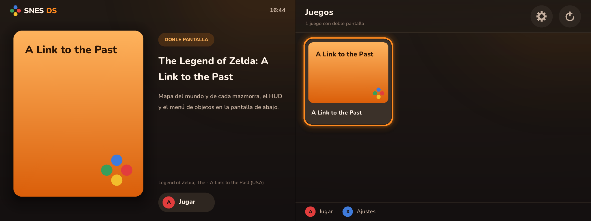
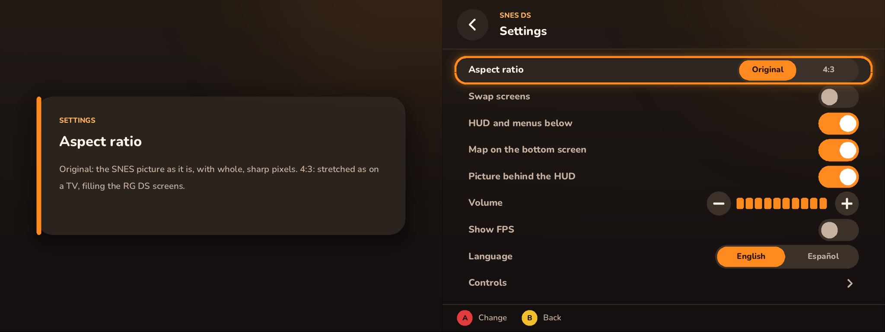
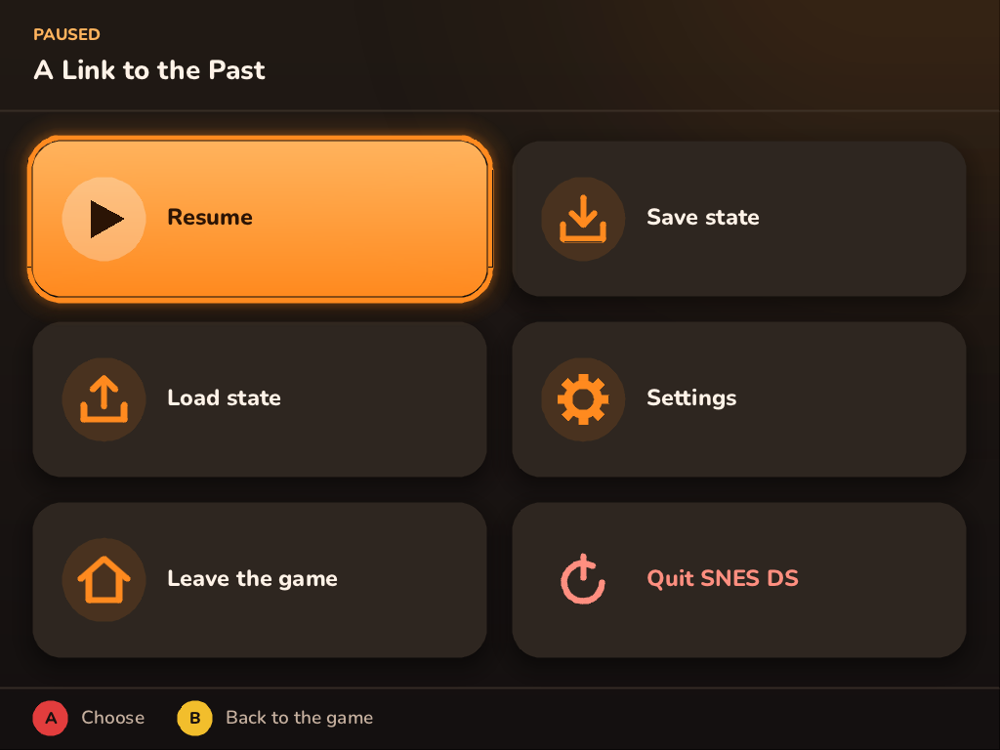
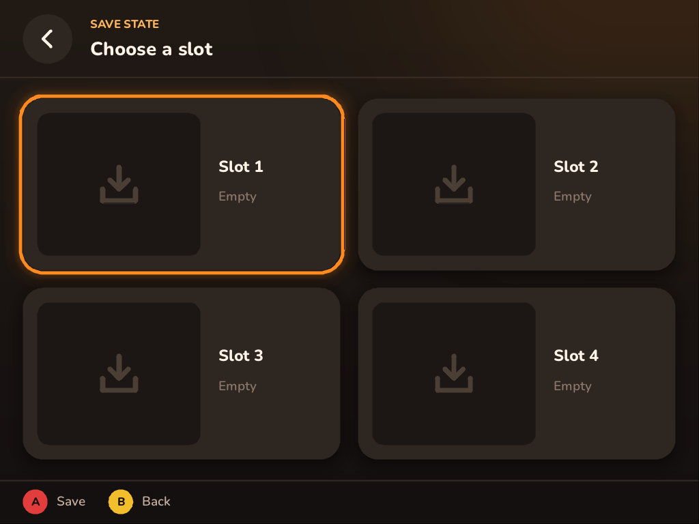
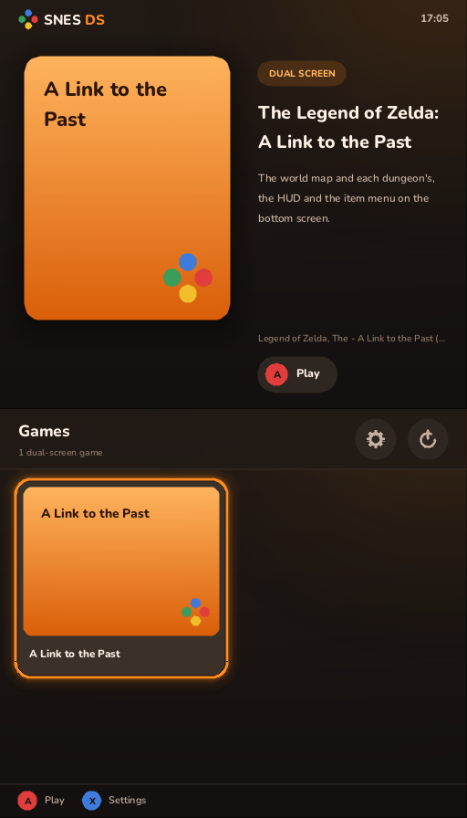
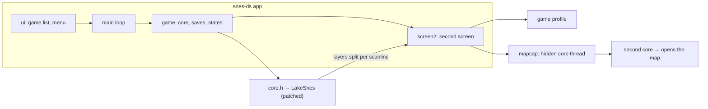

<p align="center">
  
</p>

<p align="center">
  <b>A dual-screen SNES emulator for the Anbernic RG DS Plus and RG DS.</b><br>
  The game on one screen; its map, HUD and menus on the other.
</p>

<p align="center">
  <a href="LICENSE"></a>
  
  
  
</p>

<p align="center">
  <b>English</b> · <a href="README_ES.md">Español</a>
</p>

---

SNES DS takes the idea of [gba-ds](https://github.com/kyannon/gba-ds) to the Super Nintendo. For each supported
game, a small **profile** tells the emulator which parts of the picture belong elsewhere: the HUD and the menus
move to the second screen, and a hidden second emulator core keeps the game's own **map** open there, live.

> [!NOTE]
> SNES DS is in early development. One game is supported so far; it runs at full speed on the RG DS Plus (about
> 9.5 ms per frame, with the map captured in the background).

## Contents

- [Features](#features)
- [Screenshots](#screenshots)
- [Supported games](#supported-games)
- [Installation (ROCKNIX)](#installation-rocknix)
- [Controls](#controls)
- [Building](#building)
- [Command-line options](#command-line-options)
- [How it works](#how-it-works)
- [Adding a game](#adding-a-game)
- [Testing](#testing)
- [Project layout](#project-layout)
- [Documentation](#documentation)
- [Credits](#credits)
- [License](#license)

## Features

- **Second screen per game.** HUD, menus and maps moved off the game screen, exact to the scanline: the emulator's
  picture unit can draw chosen layers into a picture of their own.
- **Live map.** A hidden core copies the game's state, opens the in-game map, waits for it to settle and records a
  few animation frames, on a background thread, every ~1.5 s and on every room change.
- **Touch interface.** A game list on the bottom (touch) screen, with covers from EmulationStation when it has
  scraped them, and a pause menu: four save-state slots with screenshots, settings, and leaving the game or the app.
  Everything works with the buttons too.
- **Picture as you like it.** The SNES' own aspect at whole-number scales, or 4:3 like a TV, filling the
  RG DS Plus' 1024×768 panels without uneven pixels.
- **Settings that stick.** Aspect, screen swap, HUD split, map, volume, an FPS counter and the language, kept in
  `snes-ds.cfg`.
- **In English and Spanish.** The interface starts in English; the language can be changed from the settings, and
  the change shows at once.
- **Battery saves** in the same `.srm` format as RetroArch, written a few seconds after they change. Saves, states
  and settings are written so that a power cut can't leave half a file.
- **ROMs** as `.sfc`, `.smc` or inside a `.zip`, recognised by CRC32 (a cache keeps startup fast with large
  libraries).
- **Headless harness** to research a game's memory and layers without the device, and to run regression tests.

## Screenshots

The device runs both panels side by side, top screen on the left. Covers are drawn by the app when none has been
scraped; no game content is shown here.

<p align="center">
  
  <br><sub>Game list: the chosen game above, the list on the touch screen below.</sub>
</p>

<p align="center">
  
  <br><sub>Settings: what the chosen setting does above, the settings below.</sub>
</p>

<table>
  <tr>
    <td width="50%"></td>
    <td width="50%"></td>
  </tr>
  <tr>
    <td align="center"><sub>Pause menu (bottom screen).</sub></td>
    <td align="center"><sub>Save-state slots, each with its screenshot and date once used.</sub></td>
  </tr>
</table>

<p align="center">
  
  <br><sub>On a PC both screens stack in one window; the mouse is the touch screen.</sub>
</p>

## Supported games

| Game | Region | CRC32 | Second screen |
|---|---|---|---|
| The Legend of Zelda: A Link to the Past | USA (v1.0) | `777AAC2F` | Live world and dungeon maps with the HUD over them; the item menu, while the world stays visible above. The HUD also leaves the game screen during dialogue and at doors. |

Each game lives in its own module under [`games/`](games); see
[games/zelda_alttp/README.md](games/zelda_alttp/README.md) for what was found about this one.

## Installation (ROCKNIX)

1. Download `snes-ds-v<version>-rocknix-aarch64.zip` (or [build it](#cross-compiling-for-rocknix)) and unzip it
   into `/storage/roms/ports/`:
   ```
   /storage/roms/ports/SNES DS.sh     the entry in Ports
   /storage/roms/ports/snes-ds/       the program
   ```
2. Put your ROMs where they already go: `/storage/roms/snes/` (subfolders and `.zip` files are fine).
3. Start **SNES DS** from Ports (restart EmulationStation if it doesn't show up yet).

The game list shows the games in that folder that have a profile. Battery saves go beside the ROM; save states go
to `snes-ds/states/`. Everything SNES DS prints goes to `snes-ds/snes-ds.log`, which also records the input devices
and the speed every 10 seconds. Device-side instructions (in Spanish) ship as
[dist/README.txt](dist/README.txt).

## Controls

SNES buttons go by position: bottom = B, right = A, top = X, left = Y.

| Action | Handheld | Keyboard (PC) |
|---|---|---|
| Pause menu | **L3** (click the left stick) · **R** (the RG DS Plus' home button) · tap the bottom screen · Select + Start | Esc · a click on the bottom screen |
| Quit | L1 + Start + Select | — |
| Save / load state (slot 1) | Select + R / Select + L (on release) | F5 / F7 |
| Swap screens | Select + X | F2 |
| Aspect: original / 4:3 | Select + Y | F4 |
| HUD on the second screen on/off | Select + A | F3 |
| Fast forward | Select + Right (toggle) | Tab (hold) |
| Fullscreen | — | F11 |

Keyboard game keys: arrows · X = A · Z = B · S = X · A = Y · Q / W = L / R · Enter = Start · Right Shift = Select.
In the app's own screens: arrows move, A (X / Enter) chooses, B (Z / Backspace) goes back.

Select still reaches the game when it's let go without a shortcut (or after being held for half a second), so games
never see the Select of a shortcut.

## Building

SNES DS is plain C11 with CMake. The app needs SDL2; without it, only the harness is built.

### Windows (MSYS2 UCRT64)

```bash
pacman -S mingw-w64-ucrt-x86_64-gcc mingw-w64-ucrt-x86_64-cmake mingw-w64-ucrt-x86_64-ninja mingw-w64-ucrt-x86_64-SDL2
cmake -S . -B build -G Ninja
cmake --build build
```

The `.exe` files are linked statically, so they run from any terminal (PowerShell, cmd) without MSYS2's DLLs.

### Linux

```bash
sudo apt install build-essential cmake ninja-build libsdl2-dev   # Debian / Ubuntu
cmake -S . -B build -G Ninja
cmake --build build
```

### Cross-compiling for ROCKNIX

```bash
scripts/build-rocknix-docker.sh   # from Windows or macOS, with Docker
scripts/build-rocknix.sh          # from x86-64 Linux with aarch64-linux-gnu-gcc/g++
```

Both produce `dist/snes-ds-v<VERSION>-rocknix-aarch64.zip`. SDL2 is built only to link against: on the device,
ROCKNIX's own `libSDL2` (with its Wayland/sway support) is used. The binary needs glibc 2.34 or later.

## Command-line options

```bash
snes-ds [options]          # the game list
snes-ds [options] ROM      # straight into a game
```

| Option | Meaning |
|---|---|
| `--rom-dir=DIR` | Where the game list looks (and in its subfolders). Default: the ROM's folder, or `.` |
| `--aspect=native\|4:3` | Picture aspect (also in the settings) |
| `--language=en\|es` | The interface's language (also in the settings; English by default) |
| `--layout=auto\|stack\|side` | Screens side by side or stacked; `auto` goes side by side on a wide window |
| `--scale=N`, `--screen=WxH` | Windowed size: the picture's scale, or each screen's size |
| `--fullscreen`, `--windowed` | Default: fullscreen under sway or KMSDRM |
| `--save-dir=DIR`, `--state-dir=DIR` | Battery saves (default: beside the ROM) and save states |
| `--config=FILE` | The settings file (default: `snes-ds.cfg` beside the program) |
| `--menu-button=NAME` | One more button for the menu: an SDL controller button name or `joy:N` |
| `--no-map`, `--no-threads`, `--no-audio` | No hidden map core · draw on the emulation's thread · no sound |
| `--stats=N` | Log the speed every N seconds (default 10, 0 off) |
| `--frames=N`, `--shot=FILE.png`, `--script=FILE` | Testing: run N frames, save a screenshot, drive the app from a script |

The full list, including the script commands, is at the top of [src/main.c](src/main.c).

## How it works



- **The core** is [LakeSnes](https://github.com/angelo-wf/LakeSnes) (MIT), vendored and patched, behind
  [`src/core.h`](src/core.h) so it can be swapped without touching anything else. The patches
  ([PATCHES.md](third_party/lakesnes/PATCHES.md)) add per-scanline layer masks (hide layers, or draw them into a
  second picture) and make it about 3.7× faster: a line-based picture unit, batched timing and a render thread,
  all checked to give bit-identical results.
- **Profiles** are data: memory probes (a byte, a mask, a value), layer-split rules, how to open the map and when a
  capture is valid. The engine in [`src/profiles.c`](src/profiles.c) knows nothing about any particular game.
- **The map** is opened on a second, hidden core running from a copy of the game's state, on a low-priority thread
  ([`src/mapcap.c`](src/mapcap.c)). The game on screen never pauses for it.
- **The interface** ([`src/ui/`](src/ui)) is drawn with SDL_Renderer alone: anti-aliased shapes, soft shadows and
  text through stb_truetype, laid out in resolution-independent units.

## Adding a game

Everything about a game lives in its own directory and nowhere else:

```
games/
  games.c                 the list of games (one line each)
  zelda_alttp/
    profile.c             its profile: all the engine sees
    README.md             its memory map, layers and findings
    tests/*.txt           its harness scripts
```

The full procedure, with the branch to use (`game/<id>`) and what a pull request needs, is in
[AGENTS.md](AGENTS.md); in short:

1. **Research it with the harness:** `layershot` shows which layer holds the HUD or a menu; `watch` and `dumpram`
   find the memory values that tell each screen apart.
2. **Write `games/<id>/profile.c`** with `const Profile game_<id> = { .id = "<id>", ... }`, plus its `README.md`
   and `tests/`.
3. **Register it** in [`games/games.c`](games/games.c): `extern const Profile game_<id>;` and `&game_<id>,`.

CMake picks up `games/*/*.c` on its own. Should a game ever need code of its own (a second screen drawn its own way, say), it goes
in its directory and its profile hooks it in, through a generic hook the engine gains first (see
[AGENTS.md](AGENTS.md#game-specific-code-and-optimisations)).

## Testing

The harness runs a game frame by frame from a script, with no window:

```bash
./build/harness ROM OUTDIR games/zelda_alttp/tests/new_game.txt
```

Its commands (presses, per-layer screenshots, `peek`/`watch`/`expect` on memory, states, map captures, `bench`,
`hash`, `audio`) are listed at the top of [tools/harness.c](tools/harness.c). For A Link to the Past:

| Script | Checks |
|---|---|
| `new_game.txt` | From power-on to the world map and the item menu: memory values, map capture, HUD split |
| `sanctuary.txt` | A dungeon: its map and the text box at the top and bottom (uses the states left by `new_game.txt`) |
| `core_check.txt` | Picture, split-picture and RAM hashes, to prove a core change gives the very same results |

The scripts exit with status 1 when anything differs. You need your own ROM; saves aren't needed, the scripts
make them. To run every game's tests in order, finding each ROM by its profile:

```bash
scripts/check.sh ROMDIR
```

## Project layout

| Path | Contents |
|---|---|
| `src/core.h`, `src/core.c` | The core interface (LakeSnes behind it) |
| `src/profiles.h`, `src/profiles.c` | The profile engine: types, lookup by CRC32, memory probes |
| `src/screen2.c`, `src/mapcap.c` | What the second screen shows; the hidden-core map capture |
| `src/main.c`, `src/game.c` | The app; the game being played (saves, states) |
| `src/ui/` | The interface: drawing (`gfx.c`) and screens (`ui.c`) |
| `src/library.c`, `src/settings.c`, `src/romfile.c` | The game list, the settings, reading ROMs and zips |
| `src/i18n.h`, `src/i18n.c` | The interface's language: each text written beside its translation, `T("Settings", "Ajustes")` |
| `src/video.c`, `src/pad.c` | Putting both screens on the window; input and shortcuts |
| `games/` | One directory per game |
| `tools/harness.c` | The headless harness |
| `dist/`, `scripts/`, `cmake/` | Device scripts, build scripts, toolchain files |
| `assets/fonts/` | Nunito (SIL OFL 1.1) |
| `third_party/` | LakeSnes (MIT, patched), kuba--/zip and miniz, stb (public domain) |

## Documentation

| Document | |
|---|---|
| [AGENTS.md](AGENTS.md) | For contributors and coding agents: rules, branches, how to add a game |
| [ROADMAP.md](ROADMAP.md) | Phases, status, measurements and risks |
| [RESEARCH.md](RESEARCH.md) | The original feasibility study: gba-ds, the hardware, choosing a core |
| [third_party/lakesnes/PATCHES.md](third_party/lakesnes/PATCHES.md) | Every change made to LakeSnes |
| [games/zelda_alttp/README.md](games/zelda_alttp/README.md) | A Link to the Past: memory map, layers, tests |

## Credits

- [gba-ds](https://github.com/kyannon/gba-ds) by kyannon, the project whose idea this follows.
- [LakeSnes](https://github.com/angelo-wf/LakeSnes) by angelo-wf, the emulation core.
- [snesrev/zelda3](https://github.com/snesrev/zelda3), whose reverse engineering pointed to A Link to the Past's
  memory addresses.
- [kuba--/zip](https://github.com/kuba--/zip) and miniz, [stb](https://github.com/nothings/stb) by Sean Barrett,
  and the [Nunito](https://github.com/googlefonts/nunito) typeface.
- [ROCKNIX](https://rocknix.org), the firmware SNES DS runs on.

SNES DS is not affiliated with Nintendo or Anbernic. It includes no games and no copyrighted game data: bring your
own legally obtained ROMs.

## License

SNES DS is free software: you can redistribute it and/or modify it under the terms of the
[GNU General Public License](LICENSE) as published by the Free Software Foundation, either version 3 of the
License, or (at your option) any later version (`GPL-3.0-or-later`). It comes with no warranty.

Third-party code under `third_party/` keeps its own license (LakeSnes: MIT; zip, miniz and stb: public domain), all
compatible with the GPL-3. The Nunito font is under the SIL Open Font License 1.1
([assets/fonts/OFL.txt](assets/fonts/OFL.txt)).
