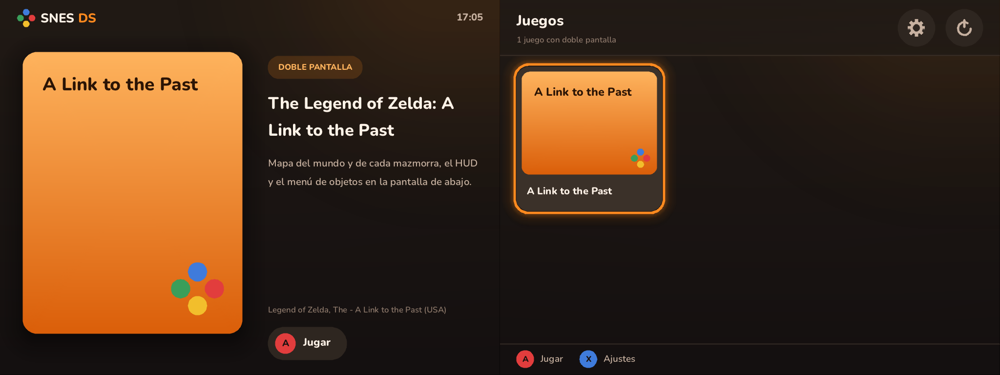
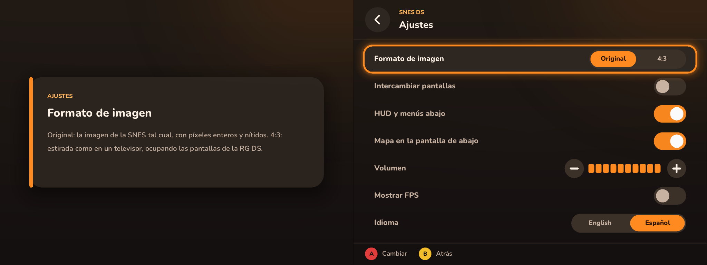
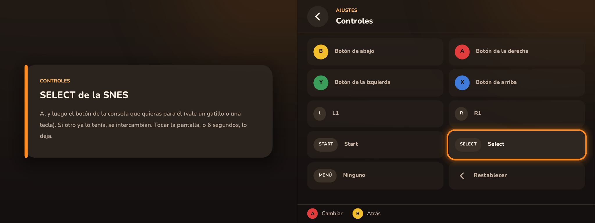
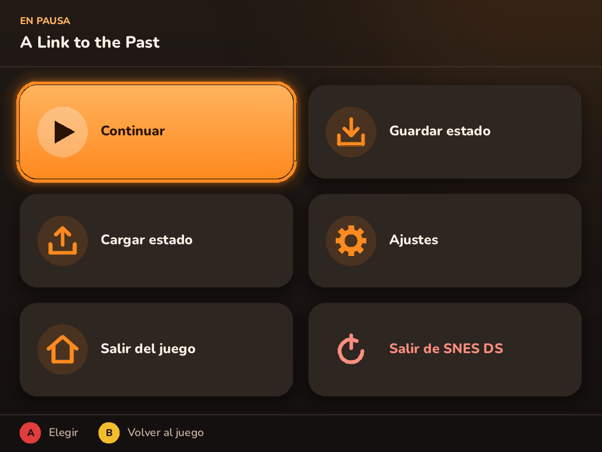
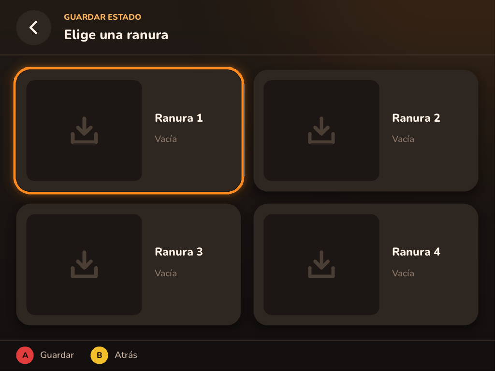
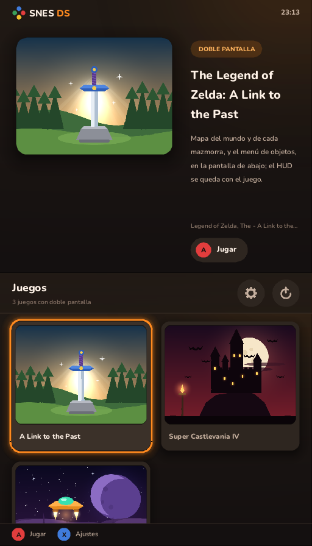
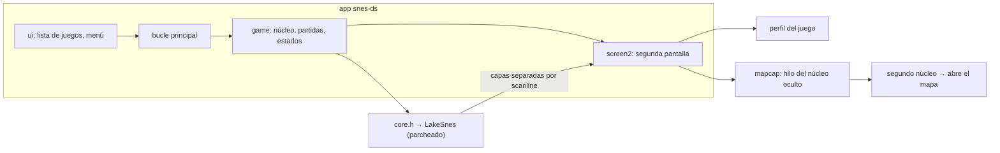

<p align="center">
  
</p>

<p align="center">
  <b>Un emulador de SNES de doble pantalla para la Anbernic RG DS Plus y la RG DS.</b><br>
  El juego en una pantalla; su mapa, su HUD y sus menús en la otra.
</p>

<p align="center">
  <a href="LICENSE"></a>
  <a href="https://github.com/lunasvalle02-design/SNES-DS/releases/latest"></a>
  <a href="https://github.com/lunasvalle02-design/SNES-DS/actions/workflows/build.yml"></a>
  
  
</p>

<p align="center">
  <a href="README.md">English</a> · <b>Español</b>
</p>

---

SNES DS lleva la idea de [gba-ds](https://github.com/kyannon/gba-ds) a la Super Nintendo. Para cada juego
compatible, un pequeño **perfil** le dice al emulador qué partes de la imagen van en otro sitio: el HUD y los menús
pasan a la segunda pantalla, y un segundo núcleo oculto mantiene allí abierto el **mapa** del propio juego, en vivo.

> [!NOTE]
> **Ya ha salido la versión 1.0**, con tres juegos: A Link to the Past, Super Metroid y Super Castlevania IV. Van a
> velocidad completa en la RG DS Plus (unos 9,5 ms por fotograma, con el mapa capturándose en segundo plano).
> [Descárgala desde la página de releases](https://github.com/lunasvalle02-design/SNES-DS/releases/latest).

## Contenido

- [Características](#características)
- [Capturas](#capturas)
- [Juegos compatibles](#juegos-compatibles)
- [Instalación (ROCKNIX)](#instalación-rocknix)
- [Controles](#controles)
- [Compilar](#compilar)
- [Opciones de línea de comandos](#opciones-de-línea-de-comandos)
- [Cómo funciona](#cómo-funciona)
- [Añadir un juego](#añadir-un-juego)
- [Pruebas](#pruebas)
- [Estructura del proyecto](#estructura-del-proyecto)
- [Documentación](#documentación)
- [Créditos](#créditos)
- [Licencia](#licencia)

## Características

- **Segunda pantalla por juego.** El HUD, los menús y los mapas salen de la pantalla de juego con precisión de
  scanline: la unidad de imagen del emulador puede dibujar las capas elegidas en una imagen aparte.
- **Mapa en vivo.** Un núcleo oculto copia el estado del juego, abre el mapa del juego, espera a que se estabilice y
  graba unos fotogramas de animación, en un hilo aparte, cada ~1,5 s y en cada cambio de sala.
- **Interfaz táctil.** Una lista de juegos en la pantalla de abajo (la táctil), con un icono para cada juego (o las
  carátulas que haya descargado EmulationStation), y un menú de pausa: cuatro ranuras de estado con captura, ajustes
  y salir del juego o de la app. Todo funciona también con los botones.
- **Los controles a tu manera.** Cualquier botón de la SNES, y uno más para el menú, se puede llevar a otro botón de
  la consola, un gatillo o una tecla, desde los ajustes.
- **La imagen a tu gusto.** La relación de aspecto original de la SNES a escala entera, o 4:3 como en un televisor,
  llenando los paneles de 1024×768 de la RG DS Plus sin píxeles desiguales.
- **Ajustes que se recuerdan.** Formato, intercambio de pantallas, separación del HUD, mapa, volumen, contador de
  FPS, idioma y controles, guardados en `snes-ds.cfg`.
- **En inglés y en español.** La interfaz arranca en inglés; el idioma se cambia en los ajustes, y el cambio se ve al
  momento.
- **Partidas** (`.srm`) en el mismo formato que RetroArch, escritas unos segundos después de cambiar. Las partidas,
  los estados y los ajustes se escriben de forma que un apagado no pueda dejar un fichero a medias.
- **ROMs** en `.sfc`, `.smc` o dentro de un `.zip`, reconocidas por su CRC32 (una caché mantiene el arranque rápido
  con bibliotecas grandes).
- **Harness sin ventana** para investigar la memoria y las capas de un juego sin la consola, y para pasar tests de
  regresión.

## Capturas

La consola muestra los dos paneles uno al lado del otro, con la pantalla de arriba a la izquierda. Los iconos de los
juegos son dibujos originales, que salen cuando no hay carátula descargada; aquí no se muestra ningún contenido de
juegos.

<p align="center">
  
  <br><sub>Lista de juegos: arriba el juego elegido, abajo la lista en la pantalla táctil.</sub>
</p>

<p align="center">
  
  <br><sub>Ajustes: arriba qué hace el ajuste elegido, abajo los ajustes.</sub>
</p>

<p align="center">
  
  <br><sub>Controles: cada botón de la SNES y el de la consola en el que está; elige uno y pulsa el nuevo botón.</sub>
</p>

<table>
  <tr>
    <td width="50%"></td>
    <td width="50%"></td>
  </tr>
  <tr>
    <td align="center"><sub>Menú de pausa (pantalla de abajo).</sub></td>
    <td align="center"><sub>Ranuras de estado; cada una muestra su captura y su fecha al usarla.</sub></td>
  </tr>
</table>

<p align="center">
  
  <br><sub>En PC las dos pantallas se apilan en una ventana; el ratón hace de pantalla táctil.</sub>
</p>

## Juegos compatibles

| Juego | Región | CRC32 | Segunda pantalla |
|---|---|---|---|
| The Legend of Zelda: A Link to the Past | EE. UU. (v1.0) | `777AAC2F` | Mapas del mundo y de las mazmorras en vivo; el menú de objetos, mientras el mundo sigue a la vista arriba. El HUD se queda en la pantalla de juego. |
| Super Metroid | Japón y EE. UU. (v1.0) | `D63ED5F8` | El mapa de pausa de la zona en la que está Samus, que se actualiza mientras explora, con el HUD (energía, munición, minimapa) encima; el HUD sigue ahí también en la pantalla de pausa. |
| Super Castlevania IV | EE. UU. (v1.0) | `B64FFB12` | El HUD (puntos, barras de vida, el arma secundaria, corazones, vidas, tiempo), al jugar y en pausa; el juego no tiene mapa. |
| Super Mario World | EE. UU. (v1.0) | `B19ED489` | El mapa del mundo tal como Mario lo dejó, con la barra de estado (vidas, objeto de reserva, tiempo, monedas, puntos) encima en los niveles. |

Cada juego vive en su propio módulo dentro de [`games/`](games), con un README sobre lo averiguado de él:
[A Link to the Past](games/zelda_alttp/README_ES.md), [Super Metroid](games/super_metroid/README_ES.md),
[Super Castlevania IV](games/super_castlevania_iv/README_ES.md). Vendrán más, cada uno en su rama (ver la
[hoja de ruta](ROADMAP_ES.md#fase-6-más-juegos-)); la lista solo muestra los juegos que tienen perfil.

## Instalación (ROCKNIX)

1. Descarga `snes-ds-v<versión>-rocknix-aarch64.zip` de la [última release](https://github.com/lunasvalle02-design/SNES-DS/releases/latest) (o
   [compílalo](#compilación-cruzada-para-rocknix)) y descomprímelo en `/storage/roms/ports/`:
   ```
   /storage/roms/ports/SNES DS.sh     la entrada en Ports
   /storage/roms/ports/snes-ds/       el programa
   ```
2. Deja tus ROMs donde siempre: `/storage/roms/snes/` (valen subcarpetas y ficheros `.zip`).
3. Abre **SNES DS** desde Ports (si aún no aparece, reinicia EmulationStation).

La lista muestra los juegos de esa carpeta que tienen perfil. Las partidas se guardan junto a la ROM y los estados
en `snes-ds/states/`. Todo lo que escribe SNES DS va a `snes-ds/snes-ds.log`, que también apunta los dispositivos de
entrada y la velocidad cada 10 segundos. Las instrucciones para la consola van en
[dist/README_ES.txt](dist/README_ES.txt), dentro del zip (en inglés, [README.txt](dist/README.txt)).

## Controles

Los botones del SNES van por posición: abajo = B, derecha = A, arriba = X, izquierda = Y. **Ajustes → Controles**
lleva cualquiera de ellos (y Start, Select, L, R, más un botón extra para el menú) a otro botón de la consola, un
gatillo o una tecla: elige el botón de la SNES y pulsa el que quieras para él. Si otro ya lo tenía, se intercambian.

| Acción | Consola | Teclado (PC) |
|---|---|---|
| Menú de pausa | **L3** (pulsar el stick izquierdo) · **R** (el botón de inicio de la RG DS Plus) · tocar la pantalla de abajo · Select + Start | Esc · un clic en la pantalla de abajo |
| Salir | L1 + Start + Select | — |
| Guardar / cargar estado (ranura 1) | Select + R / Select + L (al soltar) | F5 / F7 |
| Intercambiar pantallas | Select + X | F2 |
| Formato: original / 4:3 | Select + Y | F4 |
| HUD en la segunda pantalla sí/no | Select + A | F3 |
| Avance rápido | Select + Derecha (activa o desactiva) | Tab (mantener) |
| Pantalla completa | — | F11 |

Teclas del juego: flechas · X = A · Z = B · S = X · A = Y · Q / W = L / R · Enter = Start · Mayús dcha = Select.
En las pantallas de la app: las flechas mueven, A (X / Enter) elige y B (Z / Retroceso) vuelve.

Select sigue llegando al juego al soltarlo sin hacer un atajo (o si se mantiene medio segundo), así que los juegos
nunca ven el Select de un atajo.

## Compilar

SNES DS es C11 con CMake. La app necesita SDL2; sin él solo se compila el harness.

### Windows (MSYS2 UCRT64)

```bash
pacman -S mingw-w64-ucrt-x86_64-gcc mingw-w64-ucrt-x86_64-cmake mingw-w64-ucrt-x86_64-ninja mingw-w64-ucrt-x86_64-SDL2
cmake -S . -B build -G Ninja
cmake --build build
```

Los `.exe` se enlazan de forma estática, así que funcionan desde cualquier terminal (PowerShell, cmd) sin las DLLs
de MSYS2.

### Linux

```bash
sudo apt install build-essential cmake ninja-build libsdl2-dev   # Debian / Ubuntu
cmake -S . -B build -G Ninja
cmake --build build
```

### Compilación cruzada para ROCKNIX

```bash
scripts/build-rocknix-docker.sh   # desde Windows o macOS, con Docker
scripts/build-rocknix.sh          # desde Linux x86-64 con aarch64-linux-gnu-gcc/g++
```

Los dos dejan `dist/snes-ds-v<VERSION>-rocknix-aarch64.zip`. SDL2 se compila solo para enlazar: en la consola se
usa la `libSDL2` de ROCKNIX (con su soporte de Wayland/sway). El binario necesita glibc 2.34 o posterior.

## Opciones de línea de comandos

```bash
snes-ds [opciones]          # la lista de juegos
snes-ds [opciones] ROM      # directamente a un juego
```

| Opción | Qué hace |
|---|---|
| `--rom-dir=DIR` | Dónde busca la lista de juegos (y en sus subcarpetas). Por defecto: la carpeta de la ROM, o `.` |
| `--aspect=native\|4:3` | Formato de imagen (también en los ajustes) |
| `--language=en\|es` | El idioma de la interfaz (también en los ajustes; inglés por defecto) |
| `--layout=auto\|stack\|side` | Pantallas lado a lado o apiladas; `auto` las pone lado a lado en una ventana ancha |
| `--scale=N`, `--screen=WxH` | Tamaño en ventana: la escala de la imagen, o el tamaño de cada pantalla |
| `--fullscreen`, `--windowed` | Por defecto, pantalla completa con sway o KMSDRM |
| `--save-dir=DIR`, `--state-dir=DIR` | Partidas (por defecto, junto a la ROM) y estados |
| `--config=FICHERO` | El fichero de ajustes (por defecto, `snes-ds.cfg` junto al programa) |
| `--menu-button=NOMBRE` | Un botón más para el menú: un nombre de botón de SDL o `joy:N` |
| `--no-map`, `--no-threads`, `--no-audio` | Sin núcleo oculto del mapa · dibujar en el hilo de la emulación · sin sonido |
| `--stats=N` | Apuntar la velocidad cada N segundos (10 por defecto; 0 la desactiva) |
| `--frames=N`, `--shot=FICHERO.png`, `--script=FICHERO` | Pruebas: ejecutar N fotogramas, guardar una captura, manejar la app desde un guion |

La lista completa, con los comandos de los guiones, está al principio de [src/main.c](src/main.c).

## Cómo funciona



- **El núcleo** es [LakeSnes](https://github.com/angelo-wf/LakeSnes) (MIT), incluido en el repositorio y
  parcheado, detrás de [`src/core.h`](src/core.h) para poder cambiarlo sin tocar nada más. Los parches
  ([PATCHES.md](third_party/lakesnes/PATCHES.md)) añaden máscaras de capas por scanline (ocultar capas o dibujarlas
  en una segunda imagen) y lo hacen unas 3,7 veces más rápido: unidad de imagen por líneas, reloj por tramos y un
  hilo de dibujo, todo comprobado para dar resultados idénticos bit a bit.
- **Los perfiles** son datos: sondas de memoria (un byte, una máscara, un valor), reglas para separar capas, cómo
  abrir el mapa y cuándo una captura es válida. El motor de [`src/profiles.c`](src/profiles.c) no sabe nada de
  ningún juego en concreto.
- **El mapa** se abre en un segundo núcleo, oculto, que parte de una copia del estado del juego, en un hilo de baja
  prioridad ([`src/mapcap.c`](src/mapcap.c)). El juego en pantalla nunca se detiene por ello.
- **La interfaz** ([`src/ui/`](src/ui)) se dibuja solo con SDL_Renderer: formas suavizadas, sombras difusas y texto
  con stb_truetype, maquetado en unidades independientes de la resolución.

## Añadir un juego

Todo lo de un juego vive en su directorio y en ningún otro sitio:

```
games/
  games.c                 la lista de juegos (una línea cada uno)
  zelda_alttp/
    profile.c             su perfil: lo único que ve el motor
    README.md             su mapa de memoria, capas y hallazgos
    tests/*.txt           sus guiones del harness
    icon.py, icon.png     su icono para la lista de juegos (un dibujo original)
```

El procedimiento completo, con la rama que usar (`game/<id>`) y lo que necesita un pull request, está en
[AGENTS_ES.md](AGENTS_ES.md); en resumen:

1. **Investígalo con el harness:** `layershot` muestra qué capa lleva el HUD o un menú; `watch` y `dumpram`
   encuentran los valores de memoria que distinguen cada pantalla.
2. **Escribe `games/<id>/profile.c`** con `const Profile game_<id> = { .id = "<id>", ... }`, junto con su
   `README.md` y sus `tests/`.
3. **Regístralo** en [`games/games.c`](games/games.c): `extern const Profile game_<id>;` y `&game_<id>,`.
4. **Dibuja su icono** con `python tools/icon.py games/<id>/icon.py`: formas sencillas, nunca el arte del propio
   juego.

CMake recoge `games/*/*.c` por sí solo. Si algún día un juego necesita código propio (una segunda pantalla dibujada a su manera, por
ejemplo), irá en su directorio y su perfil lo enganchará, mediante un hook genérico que el motor gane antes (ver
[AGENTS_ES.md](AGENTS_ES.md#código-propio-de-un-juego-y-optimizaciones)).

## Pruebas

El harness ejecuta un juego fotograma a fotograma desde un guion, sin ventana:

```bash
./build/harness ROM CARPETA games/zelda_alttp/tests/new_game.txt
```

Sus comandos (pulsaciones, capturas por capa, `peek`/`watch`/`expect` sobre la memoria, estados, capturas del mapa,
`bench`, `hash`, `audio`) están al principio de [tools/harness.c](tools/harness.c). Cada juego tiene sus guiones
en `games/<id>/tests/`; los de A Link to the Past, por ejemplo:

| Guion | Comprueba |
|---|---|
| `new_game.txt` | Del encendido al mapa del mundo y el menú de objetos: valores de memoria, captura del mapa, las líneas del HUD en BG3 |
| `sanctuary.txt` | Una mazmorra: su mapa y el cuadro de texto arriba y abajo (usa los estados que deja `new_game.txt`) |
| `core_check.txt` | Hashes de la imagen, la imagen separada y la RAM, para demostrar que un cambio en el núcleo da exactamente los mismos resultados |

Los guiones salen con código 1 si algo cambia. Hace falta tu propia ROM; las partidas no, los guiones las crean.
Para pasar los tests de todos los juegos en orden, encontrando cada ROM por su perfil:

```bash
scripts/check.sh CARPETA_DE_ROMS
```

También maneja la propia app sin ventana ([`tools/app_tests/`](tools/app_tests): el menú, la página de controles)
con un mando virtual. En GitHub, [la CI](.github/workflows/build.yml) compila cada pull request para PC y para
ROCKNIX, sin permitir avisos del compilador, y adjunta el paquete de ROCKNIX a cada release etiquetada; los tests de
los juegos necesitan ROMs, así que se pasan en local antes de fusionar.

## Estructura del proyecto

| Ruta | Contenido |
|---|---|
| `src/core.h`, `src/core.c` | La interfaz del núcleo (LakeSnes detrás) |
| `src/profiles.h`, `src/profiles.c` | El motor de perfiles: tipos, búsqueda por CRC32, sondas de memoria |
| `src/screen2.c`, `src/mapcap.c` | Qué muestra la segunda pantalla; la captura del mapa con el núcleo oculto |
| `src/main.c`, `src/game.c` | La app; la partida en curso (partidas, estados) |
| `src/ui/` | La interfaz: dibujo (`gfx.c`) y pantallas (`ui.c`) |
| `src/library.c`, `src/settings.c`, `src/romfile.c` | La lista de juegos, los ajustes, la lectura de ROMs y zips |
| `src/i18n.h`, `src/i18n.c` | El idioma de la interfaz: cada texto escrito junto a su traducción, `T("Settings", "Ajustes")` |
| `src/video.c`, `src/pad.c` | Colocar las dos pantallas en la ventana; entrada y atajos |
| `games/` | Un directorio por juego |
| `tools/harness.c` | El harness sin ventana |
| `tools/app_tests/`, `tools/icon.py` | Los tests de la propia app; la herramienta que dibuja los iconos de los juegos |
| `.github/workflows/` | La CI: las compilaciones y el paquete de cada release |
| `dist/`, `scripts/`, `cmake/` | Scripts de la consola, de compilación y de toolchain |
| `assets/fonts/` | Nunito (SIL OFL 1.1) |
| `third_party/` | LakeSnes (MIT, parcheado), kuba--/zip y miniz, stb (dominio público) |

## Documentación

| Documento | |
|---|---|
| [AGENTS_ES.md](AGENTS_ES.md) | Para colaboradores y agentes: reglas, ramas, cómo añadir un juego |
| [CHANGELOG_ES.md](CHANGELOG_ES.md) | Lo que trajo cada versión |
| [ROADMAP_ES.md](ROADMAP_ES.md) | Fases, estado, medidas y riesgos |
| [INVESTIGACION_ES.md](INVESTIGACION_ES.md) | El estudio de viabilidad inicial: gba-ds, el hardware, la elección del núcleo |
| [third_party/lakesnes/PATCHES.md](third_party/lakesnes/PATCHES.md) | Todos los cambios hechos a LakeSnes (en inglés) |
| [games/zelda_alttp/README_ES.md](games/zelda_alttp/README_ES.md) | A Link to the Past: mapa de memoria, capas y tests |
| [games/super_metroid/README_ES.md](games/super_metroid/README_ES.md) | Super Metroid: mapa de memoria, capas y tests |
| [games/super_castlevania_iv/README_ES.md](games/super_castlevania_iv/README_ES.md) | Super Castlevania IV: mapa de memoria, capas y tests |

## Créditos

- [gba-ds](https://github.com/kyannon/gba-ds), de kyannon, el proyecto cuya idea sigue este.
- [LakeSnes](https://github.com/angelo-wf/LakeSnes), de angelo-wf, el núcleo de emulación.
- [snesrev/zelda3](https://github.com/snesrev/zelda3), cuya ingeniería inversa señaló las direcciones de memoria
  de A Link to the Past.
- [kuba--/zip](https://github.com/kuba--/zip) y miniz, [stb](https://github.com/nothings/stb) de Sean Barrett y la
  tipografía [Nunito](https://github.com/googlefonts/nunito).
- [ROCKNIX](https://rocknix.org), el firmware sobre el que funciona SNES DS.

SNES DS no está afiliado a Nintendo ni a Anbernic. No incluye juegos ni datos de juegos con copyright: usa tus
propias ROMs, obtenidas legalmente.

## Licencia

SNES DS es software libre: puedes redistribuirlo y modificarlo bajo los términos de la
[GNU General Public License](LICENSE) publicada por la Free Software Foundation, versión 3 o (a tu elección)
cualquier versión posterior (`GPL-3.0-or-later`). Se distribuye sin ninguna garantía.

El código de terceros de `third_party/` conserva su propia licencia (LakeSnes: MIT; zip, miniz y stb: dominio
público), todas compatibles con la GPL-3. La fuente Nunito va bajo la SIL Open Font License 1.1
([assets/fonts/OFL.txt](assets/fonts/OFL.txt)).
